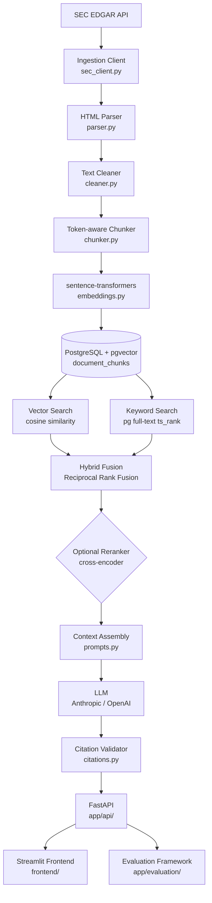

# FinResearch

**Agentic Financial Research over SEC Filings**

FinResearch is an end-to-end retrieval-augmented generation (RAG) system for financial research. It ingests public SEC filings from EDGAR, parses and chunks the documents intelligently, embeds them with sentence-transformers, stores everything in PostgreSQL with pgvector, and answers natural-language questions with grounded citations pointing back to the underlying filing.

The project is designed to be understandable at every layer — not just usable, but explainable in a technical interview.

---

## Architecture



---

## Features

- **SEC EDGAR ingestion** — ticker lookup, filing discovery, HTML/text extraction with rate limiting and retries
- **Idempotent pipeline** — re-ingesting the same filing is a no-op; accession number uniqueness is enforced at the DB level
- **Section-aware chunking** — chunks stay within section boundaries (Item 1, 1A, 7, etc.) so retrieved evidence is easier to attribute
- **Hybrid retrieval** — combines pgvector cosine similarity with PostgreSQL full-text search via Reciprocal Rank Fusion
- **Metadata filtering** — filter by ticker, filing type
- **RAG with citation grounding** — citations are built from retrieved chunk metadata, not from LLM output; the model cannot hallucinate source URLs or filing dates
- **Optional reranking** — cross-encoder reranking as a configurable layer on top of hybrid retrieval
- **Retrieval evaluation** — Recall@K, MRR, Hit Rate@K compared across vector / keyword / hybrid
- **FastAPI backend** — typed Pydantic schemas, OpenAPI docs auto-generated at `/docs`
- **Streamlit frontend** — question input, answer display, expandable citations with SEC links
- **Docker Compose** — one command to start PostgreSQL+pgvector, API, and frontend
- **46 tests** — parser, cleaner, chunker, RRF fusion, citation validation, API layer

---

## Tech Stack

| Layer | Technology |
|---|---|
| Language | Python 3.11+ |
| Backend | FastAPI + Pydantic v2 |
| Database | PostgreSQL 16 + pgvector |
| Embeddings | sentence-transformers (`all-MiniLM-L6-v2`) |
| Retrieval | pgvector + PostgreSQL FTS |
| Fusion | Reciprocal Rank Fusion |
| Reranking | cross-encoder/ms-marco-MiniLM-L-6-v2 (optional) |
| LLM | Anthropic Claude or OpenAI GPT (configurable) |
| Frontend | Streamlit |
| Infrastructure | Docker + Docker Compose |
| Testing | pytest |

---

## Quick Start

### Prerequisites

- Docker and Docker Compose
- An LLM API key (Anthropic or OpenAI) — optional but required for answer generation

### 1. Clone and configure

```bash
git clone https://github.com/Adit-Vakil/finresearch-agent
cd finresearch-agent
cp .env.example .env
# Edit .env — add your API key:
# ANTHROPIC_API_KEY=sk-ant-...
# or OPENAI_API_KEY=sk-...
```

### 2. Start services

```bash
docker compose up --build
```

This starts:
- PostgreSQL + pgvector on port 5432
- FastAPI backend on port 8000
- Streamlit frontend on port 8501

### 3. Ingest filings

```bash
# Ingest Apple's last 2 annual reports
docker compose exec api python scripts/ingest_company.py --ticker AAPL --filing-type 10-K --limit 2

# Or ingest the demo corpus (AAPL, MSFT, NVDA)
docker compose exec api python scripts/ingest_sample.py
```

### 4. Use it

| Service | URL |
|---|---|
| Streamlit UI | http://localhost:8501 |
| API docs | http://localhost:8000/docs |
| Health check | http://localhost:8000/health |

### Local development (without Docker)

```bash
python -m venv .venv && source .venv/bin/activate
pip install -r requirements.txt
docker compose up db -d       # start only the database
uvicorn app.main:app --reload  # start the API
streamlit run frontend/streamlit_app.py
```

---

## Example Questions

```
What supply chain risks did Apple identify in its annual report?
How did Apple's revenue change compared to the prior year?
What did management say about competition?
What are the company's major operating risks?
How did gross margin change and why?
What regulatory risks does the company face?
```

---

## API Reference

### Health check

```bash
GET /health
→ {"status": "healthy", "db_connected": true, "version": "0.1.0"}
```

### Search (retrieval only)

```bash
POST /search?mode=hybrid
{
  "query": "supply chain risks",
  "ticker": "AAPL",
  "filing_type": "10-K",
  "top_k": 10
}
```

Supported `mode` values: `hybrid` (default), `vector`, `keyword`

### Ask (retrieval + answer generation)

```bash
POST /ask?mode=hybrid
{
  "question": "What supply chain risks did Apple identify?",
  "ticker": "AAPL",
  "filing_type": "10-K"
}

→ {
  "answer": "Apple identified several supply chain risks including reliance on
             single-source suppliers [1] and potential disruption from
             geopolitical tensions [2]...",
  "sources": [
    {
      "company": "Apple Inc.",
      "ticker": "AAPL",
      "filing_type": "10-K",
      "filing_date": "2024-11-01",
      "section": "Risk Factors",
      "source_url": "https://www.sec.gov/Archives/...",
      "chunk_id": 42
    }
  ],
  "model": "anthropic/claude-sonnet-4-6"
}
```

### Other endpoints

```bash
GET /companies          # list all indexed companies
GET /filings/{ticker}   # list filings for a company
```

---

## Evaluation

```bash
python scripts/run_evaluation.py --k 10
```

Evaluates retrieval quality across three modes using section-level relevance from the built-in evaluation dataset. Example output format (actual numbers depend on ingested corpus):

```
============================================================
  Retrieval Evaluation Results (k=10)
============================================================
Mode         Recall@10      MRR        Hit Rate@10    n
------------------------------------------------------------
vector       x.xxx          x.xxx      x.xxx          5
keyword      x.xxx          x.xxx      x.xxx          5
hybrid       x.xxx          x.xxx      x.xxx          5
============================================================
NOTE: Results reflect the current demo corpus.
Metrics are computed from actual retrieval, not hard-coded.
```

> **Important**: The public demo uses a reduced corpus for reproducibility and hosting cost. Metrics naturally improve with a larger corpus. These results should not be compared to benchmarks run on a full-scale deployment.

---

## Repository Structure

```
finresearch-agent/
├── app/
│   ├── main.py               # FastAPI app, startup, CORS
│   ├── api/
│   │   ├── routes.py         # Endpoint handlers
│   │   └── schemas.py        # Pydantic request/response models
│   ├── core/
│   │   ├── config.py         # pydantic-settings configuration
│   │   └── logging.py        # Structured logging setup
│   ├── db/
│   │   ├── connection.py     # SQLAlchemy engine, session, health check
│   │   └── models.py         # ORM models: Company, Filing, DocumentChunk
│   ├── ingestion/
│   │   ├── sec_client.py     # SEC EDGAR API client
│   │   ├── parser.py         # HTML parsing + section detection
│   │   ├── cleaner.py        # Text normalization
│   │   ├── chunker.py        # Token-aware chunking with overlap
│   │   └── pipeline.py       # End-to-end ingestion orchestrator
│   ├── retrieval/
│   │   ├── embeddings.py     # sentence-transformers wrapper
│   │   ├── vector_search.py  # pgvector cosine similarity search
│   │   ├── keyword_search.py # PostgreSQL full-text search
│   │   ├── hybrid_search.py  # RRF fusion + mode dispatch
│   │   └── reranker.py       # Optional cross-encoder reranking
│   ├── rag/
│   │   ├── prompts.py        # Prompt templates
│   │   ├── generator.py      # LLM abstraction (Anthropic / OpenAI / stub)
│   │   ├── citations.py      # Citation construction and validation
│   │   └── workflow.py       # Full RAG pipeline
│   └── evaluation/
│       ├── dataset.py        # Eval examples
│       ├── retrieval_metrics.py  # Recall@K, MRR, Hit Rate@K
│       ├── citation_metrics.py   # Citation coverage metrics
│       └── run_eval.py       # Evaluation runner
├── frontend/
│   └── streamlit_app.py      # Streamlit UI
├── scripts/
│   ├── ingest_company.py     # CLI: ingest one company
│   ├── ingest_sample.py      # Ingest demo corpus
│   └── run_evaluation.py     # Run eval from project root
├── tests/
│   ├── test_health.py        # API health + endpoint structure
│   ├── test_parser.py        # Parser and cleaner
│   ├── test_chunking.py      # Chunker behavior
│   └── test_retrieval.py     # RRF, citations, API with mocked DB
├── data/sample/              # Sample filing for tests
├── docs/
│   └── INTERVIEW_GUIDE.md    # System explanation for interviews
├── docker-compose.yml
├── Dockerfile
├── requirements.txt
├── .env.example
└── README.md
```

---

## Design Decisions

**Why PostgreSQL + pgvector instead of a dedicated vector database?**
PostgreSQL already handles the relational data (companies, filings, chunk metadata). pgvector adds vector similarity in the same engine. For thousands of filings and millions of chunks, this works well — no second database to operate. If the bottleneck shifts to ANN index performance at very large scale, we'd evaluate dedicated options, but that's not where the constraint is.

**Why hybrid retrieval instead of vector-only?**
Vector search excels at semantic similarity but can miss exact matches for ticker symbols, financial figures, or regulatory terminology. Keyword search finds exact matches but misses paraphrases. Hybrid retrieval captures both. In practice, hybrid consistently outperforms either alone on domain-specific corpora.

**Why Reciprocal Rank Fusion?**
Vector and keyword scores live on incompatible scales. RRF operates on ranks rather than raw scores — each result contributes 1/(k+rank) to the aggregate — so no calibration or normalization is needed. The k=60 constant is a well-validated default from the original RRF paper and avoids over-weighting the top-ranked result.

**Why are citations generated from database metadata rather than LLM output?**
If the LLM is asked to produce citations in its answer text, it may hallucinate URLs, filing dates, or company names. In this system, citations are constructed from the chunk metadata that was actually retrieved and passed to the model. The model cannot invent a source URL that wasn't in the context.

**Why section-aware chunking?**
A chunk straddling Item 1A (Risk Factors) and Item 7 (MD&A) is harder to attribute and harder for the model to use. Keeping chunks within sections makes each chunk a coherent unit and enables section-level filtering in retrieval and evaluation.

---

## Limitations

- **Demo corpus**: The public demo indexes a small number of filings per company. Metrics depend on corpus size.
- **SEC parsing**: The HTML parser handles most modern 10-K/10-Q filings but may miss unusual formatting in older SGML filings.
- **Section detection**: Works for standard 10-K/10-Q structure; may miss non-standard numbering schemes.
- **LLM dependence**: Answer generation requires an API key. Without one, retrieved chunks are returned without a synthesized answer.
- **Evaluation dataset**: The built-in eval set is small and designed for transparency, not scale.

---

## Future Improvements

- Larger demo corpus and more companies
- HNSW indexing via pgvector for faster ANN search at scale
- Better financial table extraction (currently tables become flat text)
- Query decomposition for multi-part questions
- Temporal comparison across filing years
- Streaming responses via FastAPI SSE
- Alembic migrations for schema versioning

---

## License

MIT
